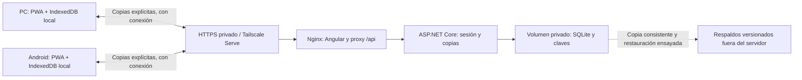
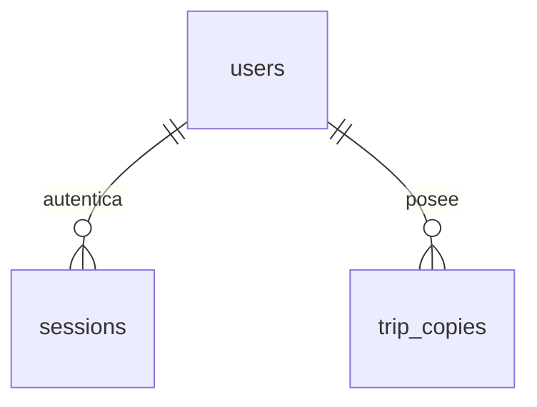

# Decisión de arquitectura y evolución

Estado: dirección de desarrollo con implementación parcial. El nuevo diseño y el
flujo PWA están implementados en Angular; faltan la instalación física, la conexión
de Angular con la API y el despliegue del servidor Linux.

## Objetivo y alcance

Primero se utilizará como cuaderno personal en PC y Android, con posibilidad de
incorporar otras personas después. La consulta de jornada, alojamiento y
abastecimiento, y la escritura del diario, deben funcionar durante una parada
sin depender de la red después de preparar la aplicación.

Se conserva Angular como web responsive y PWA instalable. IndexedDB contiene la
copia de trabajo de cada dispositivo; ASP.NET Core ofrece copias privadas en el
servidor. El uso inicial será privado. La ampliación a un producto público exige
una entrega distinta de identidad, permisos, operación y privacidad.

## Decisión

1. Una sola interfaz Angular, adaptable e instalable en Windows y Android mediante
   navegadores compatibles. APK corresponde a Android; no es un instalador Windows.
   TWA, Capacitor, Tauri, Electron o una distribución de tienda se reconsideran
   solo ante requisitos concretos que la PWA no cubra.
2. Guardar jornadas y notas primero en IndexedDB y confirmar después de tx.done.
   La disponibilidad del servidor no condiciona el trabajo local. El caché de
   aplicación y un borrador no sustituyen una nota guardada ni un respaldo.
3. Integrar primero acciones explícitas de guardar y recuperar una copia remota,
   usando el contrato de [API](api.md) existente. La sincronización automática y
   la fusión entre dispositivos se diseñarán y probarán en otra entrega.
4. Un servicio ASP.NET Core organizado por funciones y una SQLite privada en un
   solo servidor. Mantener límites entre dominio, persistencia, contratos HTTP
   y componentes; agregar responsabilidades reales, sin capas vacías.
5. Publicar web y API bajo un mismo origen HTTPS privado: Nginx sirve Angular y
   reenvía /api. La API y la base no se publican directamente en la red exterior.
6. Empezar con una stack Compose administrable desde el Linux existente. Su
   identidad, capacidad, sistema y configuración reales siguen por verificar.
   Tailscale Serve es la opción inicial de acceso privado, junto con autenticación
   de la aplicación. La configuración del servidor no se cambia con esta decisión.
7. Conservar IDs y formato de respaldo, validar antes de escribir y preservar
   campos desconocidos, textos de origen y hashes. La evolución de almacenamiento
   requiere migraciones probadas, sin eliminar la base para resolver errores.

## Topología objetivo

El siguiente esquema es el objetivo de la integración, no el despliegue actual.
Cada dispositivo tiene una copia local independiente.

La API no es necesaria para consultar o escribir sobre el cuaderno ya disponible
localmente. Si Linux o la red fallan, se conservan esas operaciones; no se promete
guardar ni recuperar copias remotas durante la interrupción. La primera carga,
la instalación y la preparación offline sí necesitan acceso a la aplicación.

Instalar no hace indestructibles los datos del navegador. Mantener un origen
estable y exportación/recuperación, y evaluar persistencia de almacenamiento
cuando esté disponible. Ni una concesión de persistencia impide que el usuario
borre los datos del sitio ni sustituye una copia fuera del dispositivo.

## Alternativas contrastadas

- Solo local y exportación JSON: ya cubre el trabajo offline y seguirá siendo
  utilizable, pero traslada al usuario el paso manual de mover y proteger copias.
- Local con copias autenticadas: elegida para la siguiente integración, porque
  aprovecha lo construido y permite recuperar el viaje desde otro dispositivo
  sin resolver todavía una fusión automática compleja.
- Servidor obligatorio para leer y escribir: no satisface el uso durante viajes
  sin señal. Puede complementar funciones futuras, sin reemplazar el núcleo local.
- Sincronización automática: útil si se necesita editar frecuentemente en varios
  dispositivos, pero requiere identidad local, cambios pendientes, reintentos
  idempotentes, versiones y resolución de conflictos. No se obtiene solo añadiendo
  una cola ni habilitando peticiones en segundo plano.
- Paquetes nativos: la instalación no obliga a cambiar de tecnología. Empaquetar
  puede aportar integración nativa o distribución de tienda, y también incorpora
  firma, actualizaciones y pruebas específicas. No crea sincronización de datos.

## Qué existe en la base y qué significa

El esquema EF actual es deliberadamente un servicio de cuentas y copias:

- users: id como clave primaria, username único y password_hash.
- sessions: id como clave primaria, user_id como clave foránea indexada y
  expires_utc. La relación elimina sus sesiones al eliminar la cuenta.
- trip_copies: clave primaria compuesta por owner_id y trip_id; owner_id es clave
  foránea de users con borrado restringido. Incluye name, backup_json,
  backup_bytes, revision positiva y updated_utc.

No existen aún tablas SQL separadas para jornadas o notas. Se guarda un JSON
validado completo por usuario y viaje. El servicio conserva la última copia;
incrementar revision no crea un historial recuperable de versiones anteriores.
Los respaldos operativos son una responsabilidad adicional.

El agregado de viaje ya separa plan, etapas, jornadas previstas, jornadas reales,
entradas, lugares y fuentes en el dominio. Véanse
[modelo de dominio](../../frontend/src/app/core/domain/model.ts) y
[configuración EF](../../backend/src/Bitacora.Api/Persistence/BitacoraDbContext.cs).
Usar un documento para una copia no implica que esas relaciones no existan.
Su integridad interna se valida en la aplicación; no es hoy una relación SQL.

### Evolución a edición remota por entidad

La normalización se justifica cuando haga falta editar entidades remotamente,
consultarlas transversalmente o colaborar dentro de un viaje. Invitar a otras
personas con viajes independientes no obliga por sí solo a sustituir el servicio
de copias ni a cambiar el motor de base.

Un modelo de partida para esa futura entrega sería:

- users posee trips; cada operación comprueba el propietario desde la sesión.
  Si aparece colaboración real, una relación de miembros de viaje define roles
  explícitos. Esa tabla no existe hoy y no se añade sin esa función.
- trips agrupa plans, stages, actual_days, places y source_snapshots.
  El plan activo debe pertenecer al mismo viaje.
- plans contiene planned_days; sus segmentos referencian stages del mismo viaje.
- actual_days es independiente del plan y tiene una fecha real única por viaje.
  diary_entries pertenece a actual_days. Una nota adicional no crea otro
  kilometraje para esa fecha ni completa automáticamente una jornada prevista.
- Las relaciones de entradas y jornadas reales con etapas, y de entradas con
  lugares, necesitan asociaciones explícitas. No confundir varios IDs con una
  única clave foránea.
- Las fuentes preservan archivos, texto original, hashes y referencias opcionales
  de procedencia. Kilómetros y montos desconocidos siguen siendo null; los CLP
  se conservan como enteros y las fechas locales como YYYY-MM-DD.

Ese modelo es una propuesta, no una migración ejecutada. Antes de adoptarlo se
debe definir compatibilidad con el respaldo v1 y sus extensiones. Si los registros
normalizados pasan a ser la fuente de escritura, el JSON de intercambio se produce
desde ellos conservando las extensiones; no mantener dos modelos editables que
puedan contradecirse. Los originales y sus hashes no se regeneran ni reescriben.

## Copias, concurrencia y varias cuentas

La copia de trabajo local y la copia remota son estados distintos. La interfaz
debe distinguir Guardado en este dispositivo, Copia remota guardada, Cambios
locales posteriores, Resultado remoto por comprobar y Conflicto de revisión.

- Leer el snapshot desde IndexedDB en una lectura consistente antes de enviarlo,
  en vez de asumir que un signal de pantalla contiene el estado más reciente de
  otras pestañas. Asociar la operación con una versión local del contenido.
- Un acuse de guardado remoto solo corresponde a ese snapshot. Si se editó el
  cuaderno durante el envío, los cambios posteriores siguen pendientes de copia.
  El mecanismo de versión local aún no está implementado y requiere migración
  y pruebas conservando identificadores y respaldos existentes.
- Crear con If-None-Match y actualizar con If-Match. Un 412 conserva ambos estados
  y pide revisión; no reintentar adoptando automáticamente el ETag más reciente.
- Si se pierde la respuesta de un PUT, el servidor podría haber confirmado.
  Mostrar resultado incierto, consultar la copia y reconciliar el contenido
  enviado antes de decidir un reintento. Una comparación debe tener semántica
  definida; exportedAt o el orden de serialización no representan por sí solos
  un cambio del contenido del viaje.
- Toda revisión remota y asociación de contenido se vincula al origen de API,
  cuenta autenticada y viaje. Nunca reutilizar un ETag de otra cuenta.
- Recuperar conserva una copia de seguridad y requiere revisar antes de
  reemplazar la copia local, comprobando también cambios que ocurran mientras
  se muestra esa revisión. No descargar ni aplicar copias privadas automáticamente
  al cambiar de cuenta.
- La API ya aísla por propietario. El almacenamiento local actual usa trip.id y
  no particiona por cuenta: antes de usar varias cuentas en el mismo perfil debe
  diseñarse una migración de espacios locales sin cambiar el identificador histórico
  de la base ni perder datos. Una separación de interfaz no cifra el dispositivo.
- Cerrar sesión remota no debe borrar silenciosamente el cuaderno offline.
  La interfaz explica qué copia permanece en ese equipo y protege el cambio de
  cuenta. No se presupone que un navegador compartido sea un dispositivo privado.

La API admite cuerpos de hasta 5 MiB; el límite local de fuentes permite hasta
10 MiB agregados. Por tanto no todo respaldo válido localmente cabe en una
petición remota. La primera integración mantiene el límite remoto finito y debe
comprobar los bytes UTF-8 del cuerpo completo antes de enviar. Si no cabe, se
conserva el viaje, se ofrece exportación y se explica el límite; nunca se trunca
ni se confirma una copia inexistente. Ampliarlo requiere alinear contrato,
cliente, proxy y servidor, además de cuotas y pruebas.

## Infraestructura inicial y recuperación

La receta actual solo construye el frontend. Faltan imagen y volumen de API,
proxy del mismo origen y su prueba conjunta. Antes de usar producción hay que
procesar las cabeceras reenviadas de proxies conocidos antes del control HTTPS:
la API exige Request.IsHttps y aún no configura ese middleware. También se debe
comprobar la dirección usada para limitar intentos de login. No confiar en
cabeceras suministradas por un cliente arbitrario ni desactivar cookies Secure
para ocultar un problema de proxy.

Mantener una sola instancia de API y SQLite en disco local persistente del
servidor. No compartir el archivo SQLite entre equipos ni publicarlo como servicio
de archivos. Guardar también las claves de Data Protection fuera de las imágenes,
con permisos privados. Conservar sesiones, antiforgery y autorización de la API
además del acceso privado de red.

La copia remota aceptada permite recuperar hasta la última versión enviada al
servidor. Los cambios locales posteriores todavía pueden perderse si se pierde
el dispositivo. La última copia del mismo Linux tampoco protege frente a la
pérdida de ese servidor.
Preparar copias versionadas y protegidas en un destino separado. Como procedimiento
inicial, detener la API y copiar base y claves de forma consistente; definir
frecuencia y retención según pérdida de datos tolerable y comprobar la restauración.
No afirmar objetivos de recuperación o alta disponibilidad sin un ensayo.

En cada cambio de esquema: detener, respaldar, ejecutar migrate una sola vez,
iniciar y comprobar salud, sesión y lectura. Volver a una imagen anterior no
revierte el esquema. No aplicar Down automáticamente. Los detalles operativos
se mantienen en [migraciones](migraciones.md) y [despliegue](despliegue.md).

Supervisar por separado web y API/SQLite, espacio disponible, errores de escritura
y antigüedad de copias recuperables. El /health actual de Nginx no comprueba la API.
No registrar contraseñas, cookies, cuerpos ni diarios. Un único Linux es un punto
de fallo; el funcionamiento local reduce su impacto en el viaje, no lo convierte
en una infraestructura de alta disponibilidad.

## Cómo crecer con evidencia

SQLite permite un escritor simultáneo por base. Se evaluará PostgreSQL si las
mediciones muestran contención de escritura sostenida que no se resuelve con
transacciones breves, si se necesitan varias instancias escritoras o si los
requisitos de disponibilidad y operación lo justifican. No se fija un número
arbitrario de usuarios como umbral, ni se promete que cambiar el proveedor EF
complete una migración: tipos, datos, consultas, índices y concurrencia requieren
pruebas sobre el motor nuevo.

Abrir Routale a público añade decisiones diferentes: acceso HTTPS público,
alta e invitaciones, recuperación de cuentas, administración y eliminación,
aislamiento local y remoto, cuotas, privacidad y operación. El tailnet privado y
las cuentas creadas por comando no constituyen todavía ese producto público.

La aplicación puede seguir organizada por funciones dentro de una API. Varios
usuarios no exigen por sí solos microservicios, un orquestador de contenedores
ni nuevas bases para cada función. Se separan servicios cuando exista una
responsabilidad operativa y una carga que lo requieran.

## Siguientes entregas y criterios de aceptación

1. Diseño y flujo de instalación PWA implementados en Angular. Falta verificar
   instalación física, cierre y reapertura en Windows y Android.
   Ver [dirección visual](direccion-visual.md).
2. Integrar sesión y copias explícitas con la API en el PC, resolviendo estados
   locales, revisiones, límite de tamaño y revisión de reemplazos.
3. Completar imagen, proxy y persistencia de API; probar migración, reinicio y
   recuperación con datos ficticios. Después revisar y ensayar el Linux real.
4. Operar privadamente y medir necesidades antes de implementar sincronización
   automática, colaboración, otra base o una distribución nativa.

Para cerrar las entregas correspondientes se comprobará:

- Con la aplicación preparada y el servidor o la red caídos, consultar y guardar
  notas locales, cerrar y volver a abrir sin perderlas. Probarlo en dispositivo
  físico, no solo en emulación de un navegador de escritorio.
- Desde dos clientes con la misma revisión, rechazar la segunda escritura remota
  sin sobrescribir. Recuperar una copia exige revisión y conserva cambios locales
  que se produzcan durante la pantalla de revisión.
- Editar durante un envío y perder una respuesta después de un commit: no marcar
  como respaldados cambios posteriores ni repetir una escritura a ciegas.
- Enviar datos inválidos o un cuerpo local válido demasiado grande para la API:
  error comprensible, sin pérdida local ni confirmación falsa.
- Restaurar base y claves sobre una instalación aislada; comprobar integridad,
  arranque, sesión válida no vencida o nuevo login, y recuperación del viaje.
- Cambiar de cuenta o trasladar el origen sin mezclar viajes ni perder datos.
  Preservar campos desconocidos, fuentes y hashes en cada ida y vuelta.

Esta lista es trabajo de validación pendiente; no afirma que se hayan ejecutado
pruebas nuevas, instalado una PWA física o conectado Linux durante esta revisión.

## Fuentes primarias y referencias de código

- [PWA en Windows con Edge](https://learn.microsoft.com/en-us/microsoft-edge/progressive-web-apps/ux).
- [Almacenamiento web por origen y persistencia](https://developer.mozilla.org/en-US/docs/Web/API/Storage_API).
- [Usos y límites de concurrencia de SQLite](https://www.sqlite.org/whentouse.html).
- [Proxy y cabeceras reenviadas en ASP.NET Core](https://learn.microsoft.com/en-us/aspnet/core/host-and-deploy/proxy-load-balancer?view=aspnetcore-10.0).
- [Tailscale Serve](https://tailscale.com/docs/features/tailscale-serve).
- [Repositorio local](../../frontend/src/app/core/storage/trip-repository.ts),
  [servicio de cuaderno](../../frontend/src/app/core/storage/cuaderno.service.ts),
  [persistencia remota](../../backend/src/Bitacora.Api/Storage/TripStore.cs)
  y [contrato actual](api.md).
